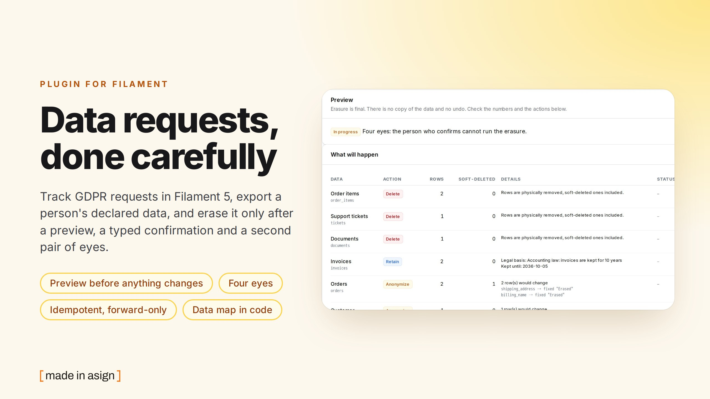
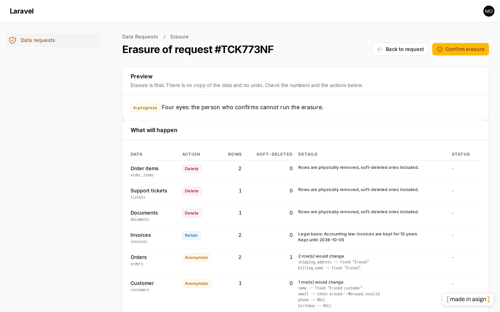
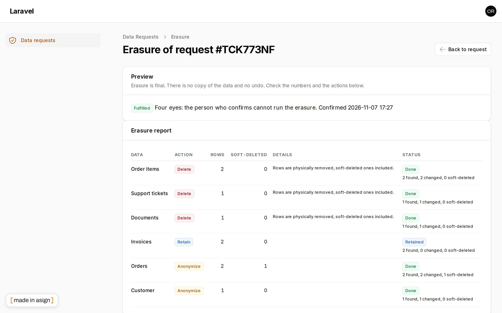
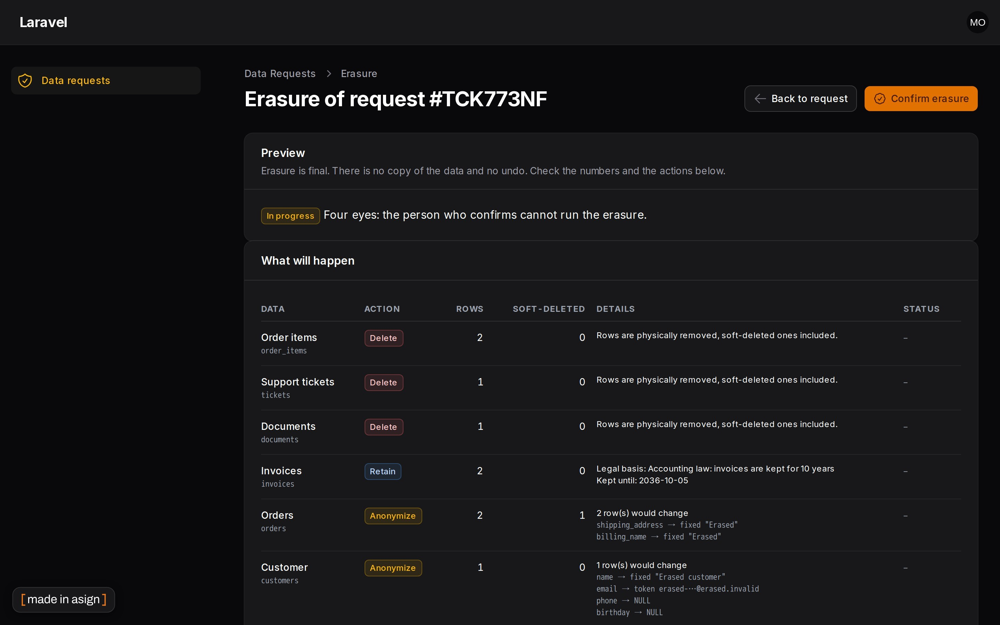
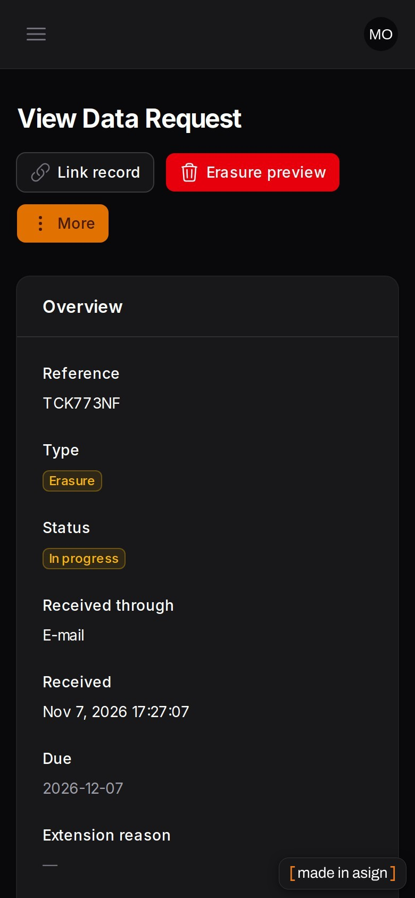

# Filament GDPR Requests

[](https://stand-with-ukraine.pp.ua)



[](https://github.com/asignua/filament-gdpr-requests/actions/workflows/tests.yml)

Somebody e-mails "please delete my data" or "send me a copy". This plugin gives your team a register for those requests
and a careful way to carry them out: a deadline that is counted for you, a record of who did what, an export built from
the data you declared, and an erasure that shows exactly what will happen before it happens.

**This is a process tool, not legal advice, and it does not make you "GDPR compliant".** It helps you run a procedure and
keep evidence of it. What counts as personal data in your application, which of it must be erased, and which must be kept,
is your decision, written down by you in the data map (below). The plugin never guesses.

## What it does

- **Register** of requests (access, erasure, rectification, restriction, portability, objection) with channel, assignee,
  internal notes and an action log. Names, addresses and notes are wiped some time after a request is closed; only a keyed
  pseudonym stays.
- **Deadline**: one calendar month from receipt (31 January + 1 month = 28 February), extendable once, with a reason, by up
  to two further months (Art. 12(3)). Reminders for the assignee before the deadline and for your administrators after it.
- **Data map in code**: for every model you say how a person's rows are found, what goes into an export and what happens
  on erasure.
- **Export**: a zip with JSON files (Cyrillic and accents are not escaped) plus the files you name, on a private disk,
  behind a short-lived signed link that works only for the person it was issued to, deleted automatically after 30 days.
- **Erasure**: a mandatory preview (how many rows, which action, what would break), a typed confirmation, a different
  person to run it (four eyes), one queued job and one transaction per group, and a report per model.
- **Retention policies**: `gdpr:retention`, a dry run unless you add `--apply`.

## Screenshots






## Requirements

- PHP 8.3+, Laravel 12 or 13, Filament 5, `ext-zip`
- SQLite, MariaDB 11.4 or PostgreSQL 16 (all three are tested)
- A queue worker. With `QUEUE_CONNECTION=sync` everything runs inline, which is fine for small data and for development.
- A **single database connection**: the plugin tables and every mapped table must be on the default connection (a
  transaction cannot span two).
- No tenancy: panels with tenancy are **not supported in v1**. The resource closes itself there and the services and
  commands refuse to run.

## Installation

```bash
composer require asignua/filament-gdpr-requests
php artisan vendor:publish --tag=filament-gdpr-requests-migrations
php artisan migrate
```

Create a key for pseudonyms and put it in `.env` (at least 32 characters):

```bash
php -r "echo bin2hex(random_bytes(32)), PHP_EOL;"
```

```dotenv
GDPR_PSEUDONYM_KEY=...
```

Register the plugin:

```php
use Asignua\FilamentGdprRequests\GdprRequestsPlugin;

$panel->plugin(GdprRequestsPlugin::make()->navigationGroup('Compliance'));
```

### The four gates (denied until you define them)

Every ability is **denied by default**. Define them in a service provider:

```php
Gate::define('gdpr.view',   fn (User $user) => $user->hasRole('compliance'));        // see the register
Gate::define('gdpr.manage', fn (User $user) => $user->hasRole('compliance'));        // create, link, verify, extend, refuse, close
Gate::define('gdpr.export', fn (User $user) => $user->hasRole('dpo'));               // prepare and download exports
Gate::define('gdpr.erase',  fn (User $user) => $user->hasRole('dpo'));               // confirm and run erasures
```

The services check the gates again themselves, so a custom page or a console script cannot reach an irreversible step
around the UI. A global `Gate::before` that returns `true` for super admins applies here as everywhere.

## The data map

The map is the only way the plugin finds personal data. There is no search and no `LIKE`. Declare it in a service
provider's `boot()`:

```php
use Asignua\FilamentGdprRequests\DataMap\{Erase, PersonalData, Retention, Rule};
use Spatie\MediaLibrary\MediaCollections\Models\Media;

// The data subject itself (a user, a customer).
PersonalData::for(Customer::class)
    ->label('Customer')
    ->subject(email: 'email')                                  // found by primary key; the address e-mail groups match on
    ->export(['id', 'name', 'email', 'phone', 'created_at'])   // exactly these columns, nothing else
    ->erase(Erase::anonymize([
        'name'           => Rule::fixed('Erased customer'),
        'email'          => Rule::uniqueToken('erased-', '@erased.invalid'),
        'phone'          => Rule::null(),
        'password'       => Rule::fixed('!'),                  // no hash matches it: nobody can log in any more
        'remember_token' => Rule::null(),                      // otherwise an old "remember me" cookie still works
    ]));

// Files of spatie/laravel-medialibrary. Writes bypass model events, so the library does not clean up after itself:
// name the original and every conversion here, or they stay on the disk.
PersonalData::for(Media::class, 'customer-media')
    ->label('Uploaded files')
    ->of(Customer::class)
    ->matchedUsing(fn ($query, $subject) => $query->where('model_type', (new Customer)->getMorphClass())->where('model_id', $subject->keyValue()))
    ->export(['id', 'file_name', 'created_at'])
    ->files(fn (Media $media) => collect(['', ...array_keys(array_filter($media->generated_conversions ?? []))])
        ->map(fn (string $conversion) => ['disk' => $media->disk, 'path' => $media->getPathRelativeToRoot($conversion)]))
    ->erase(Erase::delete(files: true));

// Rows that belong to the subject.
PersonalData::for(Order::class)
    ->of(Customer::class)
    ->matchedBy('customer_id')
    ->export(['id', 'number', 'total', 'shipping_address'])
    ->erase(Erase::anonymize(['shipping_address' => Rule::fixed('Erased')]));

PersonalData::for(Ticket::class)
    ->of(Customer::class)
    ->matchedByEmail('customer_email')                         // exact match after trim (any white space) + lowercase
    ->erase(Erase::delete());

PersonalData::for(Invoice::class)
    ->of(Customer::class)
    ->matchedBy('customer_id')
    ->erase(Erase::retain('Accounting law: 10 years', days: 3650, from: 'issued_at'))
    ->retention(Retention::after(days: 3650, from: 'issued_at')->then(Erase::anonymize(['billed_to' => Rule::hash()])));

PersonalData::for(Document::class)                           // rows reached through another table
    ->of(Customer::class)
    ->matchedUsing(fn ($query, $subject) => $query->whereIn('order_id', Order::query()->withoutGlobalScopes()->where('customer_id', $subject->keyValue())->select('id')))
    ->files(fn (Document $d) => [['disk' => $d->disk, 'path' => $d->path]])
    ->erase(Erase::delete(files: true));

// A table that references a mapped table but holds nothing about the person:
GdprRequests::acknowledge('audit_notes', 'Internal notes, no personal data.');
```

> [!WARNING]
> **Anything that is not in the map stays.** A column without a rule keeps its value, a table without an entry keeps its
> rows, and a request can still read *Fulfilled*: the plugin finishes what you declared, not what you meant. Go through your
> schema before the first real erasure, and remember the columns that are easy to forget: password hashes, remember
> tokens, sessions, API tokens, notifications, media.

How to write it well:

- **One entry per model that holds the person's data**, and one root entry with `subject()`. Declare every column you want
  anonymized: a column without a rule is **not touched**, and a model without rules is not anonymized. There are no
  defaults.
- **One declaration per group.** A model is its own group; to map it twice give the second entry a name
  (`PersonalData::for(Media::class, 'customer-media')`). Declaring the same group again throws instead of quietly replacing
  the first entry (whose rows would then be left out). To replace one on purpose, `app(PersonalDataRegistry::class)->forget($group)` first.
- **Rules** are `Rule::null()`, `Rule::fixed($v)`, `Rule::hash()` (keyed digest, recognises its own output), `Rule::uniqueToken()`
  (for unique columns: derived from table, column and row key, so a rerun gives the same value) and `Rule::using(fn)` (yours;
  it must give the same result when applied to its own output; pass `unique: true` to vouch for a unique column).
- **The linked record decides who a request is about.** E-mail groups match on the address of the root row, not on what
  was typed on the request. Declare it with `subject(email: 'email')`: without it, an entry using `matchedByEmail()` blocks
  the run.
- **Addresses** are compared after trimming white space (invisible characters included) and PHP's `mb_strtolower`. The
  database narrows the rows and PHP decides. Two letters lowercase differently in PHP and in SQL (`İ`, and a word-final
  `Σ`); the query folds both so that it never misses such an address. For every other letter the query relies on the
  server's own lowercase tables (on SQLite PHP answers itself). Before any preview, run, export or command the plugin asks
  the server to lowercase capitals of Latin, Greek, Cyrillic and Armenian and **refuses to work** when the answer differs
  from PHP's: a Postgres database created with `LC_CTYPE 'C'` lowercases ASCII only and would miss `ÄDA@…`. Use a
  Unicode `LC_CTYPE` (Postgres) or a Unicode `utf8mb4` collation (MariaDB). An address in a script your server's version
  of Unicode does not know may still be missed, so check such rows by hand.
- **Soft-deleted rows are always included.** Global scopes are removed from every query the plugin runs, including the
  subqueries a `matchedUsing()` closure builds through other models while it runs. `delete` really
  removes rows, soft-deleted ones too.
- **Writes bypass model events** (an observer must not send mail mid-erasure) and do not touch `updated_at`.
- **`retain`** keeps the row whole, shows the legal basis and the date up to which it is kept in the preview and the
  report, and after that date merely lists the row in `gdpr:retention`. It never changes anything by itself.
- **Third parties.** An export contains only the columns you list. If a listed column (a message body, a note) mentions
  other people, that is your call when you write the map; the plugin does not read the content.
- **Pseudonyms need the key**. `GDPR_PSEUDONYM_KEY` signs subject and e-mail pseudonyms (HMAC-SHA256) and the `hash` and
  `uniqueToken` rules. Without it the plugin refuses; it never falls back to `APP_KEY`. The key version is stored with
  each request. To rotate: set a new key, raise `GDPR_PSEUDONYM_KEY_VERSION`, and list the old one under
  `pseudonym.previous_keys` (`[1 => 'old key']`) so older pseudonyms can still be recomputed. Losing the key means old
  pseudonyms can no longer be matched, so keep it with your other secrets.

### What the preview blocks

Before anything can be confirmed, the preview reads your live schema and **blocks** the run when:

- a rule writes `NULL` into a `NOT NULL` column, a value that is too long, or text into a number or date column;
- a fixed value would go into a unique column of more than one row, or another row already holds it;
- a callback targets a unique column without `unique: true`;
- a rule targets the primary key, the column the rows are found by, a foreign-key column (other than `NULL`) or a column
  another table references;
- a file this run would remove is still named by a row that stays, of any entry with `files()` in the whole map (two
  records sharing one path): the message names the tables, not the people. Every row of those tables is read for this,
  so keep `files()` resolvers cheap;
- another entry anonymizes or deletes rows that a `retain` entry keeps: the report would call them kept;
- a row you delete is still referenced by rows that are not deleted with it (soft-deleted ones counted);
- a row you delete names files through `files()` and the strategy does not remove them: use `Erase::delete(files: true)`,
  because the row is the only thing that knows where its file is. The same holds for an anonymization that changes the
  columns a file is found by (a path set to `NULL` or a constant) without `files: true`;
- a table that is not in this subject's map references a mapped table (add it, or `GdprRequests::acknowledge()` it). A table
  mapped only for another subject does not count;
- a callback changes its own output: the check after the run could never tell a finished row from an unfinished one;
- a `matchedUsing()` (or retention) query uses a limit, an offset, `DISTINCT`, `GROUP BY`/`HAVING` or a `UNION`: rows are
  read by key in chunks, and such a clause would apply per chunk. An `ORDER BY` of the closure is simply dropped;
- a `matchedUsing()` query reads a table this run changes and foreign keys force that table to go first. Otherwise such a
  closure simply runs before every other group that changes a table it reads, its own table included;
- rows hold almost the person's key (other letter case, padding): the plugin matches exactly and does not guess whose they
  are. The export is refused for the same reason. Correct the rows;
- the linked record cannot be found, the address on the request differs from the record's, or an e-mail group has no
  address to match on, or several records share that address (soft-deleted ones too), since it could not tell whose rows
  are whose. The export is refused for the same reasons. A person settles a difference: link the right record, or use
  **Accept the record's e-mail** (which removes export archives and asks for the identity check again). On a partial
  erasure whose record changed its address before the record itself was erased, the same action is the way forward: the
  request stays partial and needs a new identity check and a new confirmation;
- an entry has no way to find rows, a table or column does not exist, a rule throws, or the pseudonym key is missing.

## How a request goes

1. **New request**: from the panel, or from your own form with `GdprRequests::submit(RequestType::Erasure, email: ..., ...)`.
   A submitted request is **always unverified**.
2. **Link the record** by explicit key (or by exact e-mail through the column your map declares).
3. **Verify the identity**, outside the tool, and write down how in the note. Export and erasure are locked until you do;
   re-linking the record clears the verification and removes the archives made for the previous one. Once an erasure has
   changed data, the record can no longer be changed.
4. **Export** (access and portability): a job builds the archive; **Download** issues a signed link (15 minutes) bound to
   your user.
5. **Erasure preview, Confirm** (typing the request reference), then **a different person runs it** (typing the
   reference again). `four_eyes` can be switched off for a single administrator; every erasure run while it is off is written
   to the log.
6. **Check**: when the groups are done the plan is built again for the same person. Any row the plan said would go, any
   file that should be gone, or any difference between rows planned and handled keeps the request **Partially erased**,
   with the list on the erasure page and in the log. Retained rows do not count: the plan said they stay.
7. **Report**: one line per entry (found, changed, soft-deleted) and the status of each group. When the check is clean,
   every export archive of that person is removed, from their other requests too; only then the request reads *Fulfilled*.
8. **Close**: a fulfilled erasure closes itself: the link to the person's record is cut and the `request_retention_days`
   clock starts. **Complete** and **Refuse** start that clock too; close such a request by hand to cut the link and
   remove the archives the same way (closing later does not restart the clock).

### Irreversible means irreversible

- There is no copy of the erased data (a copy would itself be personal data) and no rollback of a finished group.
- Each group is one transaction together with its own "done" mark, and the request row is locked first, so two workers on
  one request take turns. If a group fails, the request becomes **Partially erased** (never a success), the groups that
  finished stay finished, and **Resume** only goes forward. A rerun of a finished group changes nothing.
- A confirmation is bound to the data map's rules, to the person and to the row counts you saw. If any of them changed, or
  72 hours passed, confirm again. A first run that finds fewer rows than you confirmed fails the group: rows that cannot be
  reached are no good news.
- New rows or a fixed map after a partial run: **Resume** refuses, and the way forward is a fresh preview and **Confirm**,
  four eyes included. Every group runs again under the new plan; what the earlier run did stays on the report and in the
  log. A partial erasure cannot be relinked or refused: its rows are gone.
- The check sees what the map can reach. A `matchedUsing()` closure that reads a table the run erased finds nothing
  afterwards, so rows added to such a group after that table was erased stay out of sight. Match on a column where you can.
- Files named by the entry are removed after the commit; if one cannot be removed the group stays failed and the list of
  what is left is kept. **Resume** retries them, and the group finishes when they are gone.
- A killed worker cannot leave a request stuck: a failed job moves it to **Partially erased**, and a run that has gone quiet
  for `erasure.stale_run_minutes` (30) offers **Resume**.

## Housekeeping commands

Nothing is scheduled for you. Add what you want:

```php
Schedule::command('gdpr:remind')->dailyAt('08:00');
Schedule::command('gdpr:prune')->dailyAt('03:30');
// Deliberately your decision, and the only place where --apply appears:
// Schedule::command('gdpr:retention --apply')->weeklyOn(1, '04:00');
```

| Command | What it does |
| --- | --- |
| `gdpr:retention` | Plans the retention policies of the map. **Dry run by default**; changes rows only with `--apply`. No config key turns it on. `--only=<group or model>`. |
| `gdpr:prune` | Removes expired export archives and wipes name, address, message and notes of requests that ended (fulfilled, refused or closed) longer than `request_retention_days` ago. `--dry-run` to look first. |
| `gdpr:remind` | Notifies the assignee `reminders.days_before` days before the deadline and your administrators when it is passed. Define who those are with `GdprRequests::notifyAdminsUsing(fn () => User::...)`: **without it nobody but the assignee hears about an overdue request**, and the command warns you. |

Every run is recorded in `gdpr_runs`, dry runs included. A file or archive that cannot be deleted is reported, and
`gdpr:prune` and `gdpr:retention --apply` exit with a failure: an archive stays on record and is retried, and the paths of
files whose row is gone are in the run's summary. A reminder is marked as sent only if it reached somebody; otherwise the
next run tries again.

## What this does NOT cover

- **Backups.** Erased data lives on in database dumps and snapshots. Agree a retention period for backups that fits your
  answer to the person, and document it. The plugin cannot reach them.
- **Logs** outside the database (web server, application, queue, mail), search indexes, caches, analytics.
- **External systems** (e-mail providers, CRMs, payment services). Map what is in your database; tell the others yourself.
- **Data not in the map.** If you forgot a table, it is not found. The schema checks above catch tables that reference a
  mapped table, nothing more.
- **Finding the person** beyond the explicit key and your declared e-mail column, **verifying identity online**, a
  **public request form**, consent banners and the **record of processing** (Art. 30) are out of scope. `GdprRequests::submit()`
  is there for your own form.

## Configuration

Publish with `php artisan vendor:publish --tag=filament-gdpr-requests-config`. The ones you will touch:

| Key | Default | |
| --- | --- | --- |
| `four_eyes` (`GDPR_FOUR_EYES`) | `true` | The person who runs an erasure must not be the one who confirmed it. |
| `export.disk` (`GDPR_EXPORT_DISK`) | `local` | Must be private; a disk with public visibility, or inside `public/`, is refused. |
| `export.retention_days` | `30` | Archive lifetime. |
| `request_retention_days` | `90` | Days after a request ended (fulfilled, refused or closed) before name, address and notes are wiped. |
| `extension_max_months` | `2` | Extra months allowed by one extension. |
| `requester_mail.enabled` | `false` | Stage e-mails to the person (received, extended, completed, refused). |
| `erasure.stale_run_minutes` | `30` | A run with no sign of life for this long may be resumed. |
| `queue.connection` / `queue.name` | default | Where the jobs go. |

Tables are `gdpr_requests`, `gdpr_request_events`, `gdpr_request_steps`, `gdpr_request_exports` and `gdpr_runs` (no prefix).
The plugin's JSON columns are written without Unicode escaping.

## Activity Log Plus (optional)

If [asignua/filament-activity-log-plus](https://github.com/asignua/filament-activity-log-plus) (spatie activitylog) is
installed, every request action is mirrored there under the log name `gdpr`, with the request reference and counts only,
never names or addresses. This mirror is covered by a test against a stand-in for the `activity()` helper, **not** against
the real package, which needs PHP 8.4 and is not installed in this plugin's test suite.

## Try it in the workbench

```bash
vendor/bin/testbench workbench:build
vendor/bin/testbench filament:assets
vendor/bin/testbench db:seed --class="Workbench\Database\Seeders\DatabaseSeeder"
vendor/bin/testbench serve
```

Everything in it is invented. Log in at `/admin` as `marta@example.test` (confirms erasures), `oleh@example.test` (runs
them: four eyes) or `nina@example.test` (a manager without export and erase rights), password `password`.
`testbench.yaml` uses the `file` cache on purpose: Filament 5.11 keeps notifications in the cache, and the `array` store
loses them between requests.

## Translations

Ten languages: English and Ukrainian were written by the author, **the other eight (pl, de, es, fr, it, nl, pt_BR, tr) are
machine translations** that a native speaker has not reviewed. Please send corrections. A test keeps every language in step
with the English keys and checks that placeholders survive. Publish with `--tag=filament-gdpr-requests-translations`.

## Testing

```bash
composer install
vendor/bin/phpunit
vendor/bin/phpstan analyse --memory-limit=1G --no-progress
vendor/bin/pint --test
```

The suite runs on SQLite. `tests/Database` holds scenarios that need a real server (a genuine unique violation in the
middle of a run, two processes on one request); they run when `GDPR_TEST_DB=mariadb|pgsql` points at a database
(`GDPR_TEST_DB_HOST`, `_PORT`, `_NAME`, `_USER`, `_PASSWORD`) and are skipped otherwise. `GDPR_TEST_FOREIGN_DB` names a
neighbouring database (a schema on Postgres) with the tables `customers` (one row, `marker = 'sentinel'`), `foreign_only`
and `foreign_child`, and adds the proof that the schema reader stays inside its own database.

## AI agents

The package ships [Laravel Boost](https://laravel.com/docs/boost) guidelines (`resources/boost/guidelines/core.blade.php`).

## More plugins by asign

- [Activity Log Plus](https://filamentphp.com/plugins/asign-activity-log-plus) — audit trail and history for models
- [Mail Log](https://filamentphp.com/plugins/asign-mail-log) — every outgoing e-mail, with delivery status
- [XLSX Export](https://filamentphp.com/plugins/asign-xlsx-export) — spreadsheet exports for tables
- [Record Lock](https://filamentphp.com/plugins/asign-record-lock) — one editor per record

All plugins: <https://filamentphp.com/plugins?q=asign>

## Changelog

See [CHANGELOG.md](CHANGELOG.md).

## License

The MIT License (MIT). See [LICENSE.md](LICENSE.md).
